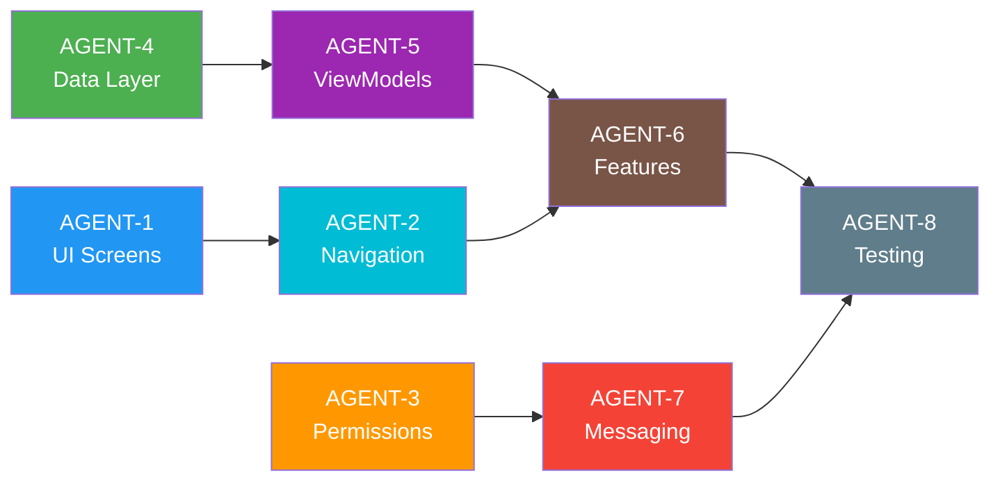

# 🤝 Agents Work Assignment

## Project: SMSApplication — Agent Delegation Plan

> This document defines how autonomous AI agents are assigned to implement each phase and feature of the SMS Application. Each agent has a clear scope, deliverables, dependencies, and acceptance criteria.

---

## Agent Team Overview

| Agent ID | Role | Scope |
|----------|------|-------|
| **AGENT-1** | UI Architect | Screen design, Compose UI, Theme |
| **AGENT-2** | Navigation Engineer | NavGraph, routing, transitions |
| **AGENT-3** | Permission Specialist | Runtime permissions, default SMS flow |
| **AGENT-4** | Data Layer Engineer | Room DB, ContentResolver, Repository |
| **AGENT-5** | ViewModel Engineer | ViewModels, UseCases, StateFlow |
| **AGENT-6** | Feature Engineer | Search, Filter, Sort, Tags, Folders |
| **AGENT-7** | Messaging Engineer | SMS Send/Receive, BroadcastReceiver |
| **AGENT-8** | Test Engineer | Unit tests, UI tests, instrumented tests |

---

## AGENT-1 — UI Architect

### Responsibility
Design and implement all Jetpack Compose screens following Material 3 Expressive design language.

### Tasks
- [ ] `SplashScreen.kt` — Animated logo with spring-motion entrance
- [ ] `HomeScreen.kt` — Conversation list with FAB, search bar, sort menu
- [ ] `ConversationScreen.kt` — Chat-bubble thread view
- [ ] `ComposeScreen.kt` — New SMS composer with contact picker
- [ ] `SearchScreen.kt` — Full-text search with chips filter
- [ ] `ContactsScreen.kt` — Contact list with avatars
- [ ] `FoldersScreen.kt` — Folder grid with icons
- [ ] `TagsScreen.kt` — Tag management with color picker
- [ ] `SettingsScreen.kt` — Preferences list
- [ ] `PermissionsScreen.kt` — Permission rationale UI
- [ ] Shared components: `ConversationCard`, `MessageBubble`, `ContactAvatar`, `TagChip`, `FilterBottomSheet`, `SortMenu`
- [ ] `ui/theme/` — Color, Typography, Shape, Motion tokens

### Deliverables
- All screens render correctly in Compose Preview
- Dark mode support verified
- Adaptive layout for different screen sizes

### Dependencies
- `designlanguage.md` (AGENT-1 reads this first)
- `screenlayout_design.md`

---

## AGENT-2 — Navigation Engineer

### Responsibility
Implement Navigation Compose graph, bottom navigation bar, and screen transitions.

### Tasks
- [ ] `Screen.kt` — Sealed class with all route definitions
- [ ] `AppNavGraph.kt` — NavHost with all destinations
- [ ] `BottomNavBar.kt` — 5-item bottom navigation (Home, Search, Compose, Contacts, Settings)
- [ ] `NavigationDrawer.kt` — Side drawer for Folders
- [ ] Deep link setup for notification taps → `ConversationScreen`
- [ ] Shared element transitions between `HomeScreen` → `ConversationScreen`
- [ ] Back stack management (popUpTo, launchSingleTop)

### Deliverables
- Full navigation graph wired and functional
- All screens reachable from entry point
- Back navigation behaves correctly on all screens
- Deep links resolve correctly

### Dependencies
- AGENT-1 (screens must exist as stubs)
- `flowchart.md` — Navigation Graph (diagram 2)

---

## AGENT-3 — Permission Specialist

### Responsibility
Implement Android runtime permission flow and default SMS app setup.

### Tasks
- [ ] `PermissionManager.kt` — Centralized permission state manager
- [ ] `PermissionsScreen.kt` — UI for requesting each permission with rationale
- [ ] `DefaultSmsHelper.kt` — Logic to prompt user to set app as default SMS
- [ ] Handle "never ask again" state gracefully (open app settings)
- [ ] Permission check on app resume (re-check if revoked)
- [ ] Support Android 13+ granular media/notification permissions

### Permissions Handled
```kotlin
Manifest.permission.READ_SMS
Manifest.permission.SEND_SMS
Manifest.permission.RECEIVE_SMS
Manifest.permission.READ_CONTACTS
Manifest.permission.READ_PHONE_STATE
Manifest.permission.RECEIVE_MMS
Manifest.permission.POST_NOTIFICATIONS  // API 33+
```

### Deliverables
- `PermissionsScreen` shown when any critical permission is missing
- App gracefully degrades if contact permission denied (shows numbers only)
- Default SMS prompt shown once per session
- All permission edge cases handled (revoked, denied, never-ask-again)

### Dependencies
- `permissions.md`

---

## AGENT-4 — Data Layer Engineer

### Responsibility
Build the data layer: Room database, ContentResolver wrappers, and repository implementations.

### Tasks

#### Room Database
- [ ] `SmsDatabase.kt` — Room DB setup
- [ ] `TagEntity.kt` + `TagDao.kt` — Tag storage
- [ ] `FolderEntity.kt` + `FolderDao.kt` — Custom folder rules
- [ ] `SearchHistoryEntity.kt` + `SearchHistoryDao.kt` — Recent searches
- [ ] `SmsMetadataEntity.kt` + `SmsMetadataDao.kt` — Local overrides (starred, archived, deleted)

#### Content Resolvers
- [ ] `SmsContentResolver.kt` — Query `content://sms/`, `content://sms/inbox`, `content://sms/sent`, `content://sms/draft`
- [ ] `ContactsContentResolver.kt` — Query `ContactsContract.Contacts` and `CommonDataKinds.Phone`
- [ ] `MmsContentResolver.kt` — Basic MMS read support

#### Repositories
- [ ] `SmsRepositoryImpl.kt` — Implements `SmsRepository` interface
- [ ] `ContactRepositoryImpl.kt` — Implements `ContactRepository` interface

### Deliverables
- Room DB migrations handled
- ContentResolver queries run on IO dispatcher
- Repository exposes `Flow<List<T>>` for reactive UI updates
- Unit tests for DAO operations

### Dependencies
- None (can start in parallel with AGENT-1)

---

## AGENT-5 — ViewModel Engineer

### Responsibility
Implement all ViewModels and Use Cases connecting data layer to UI.

### Tasks

#### Use Cases
- [ ] `GetConversationsUseCase.kt` — Paginated conversation list
- [ ] `GetMessagesUseCase.kt` — Messages in a thread
- [ ] `SendSmsUseCase.kt` — Send via SmsManager
- [ ] `SearchSmsUseCase.kt` — Full-text search with debounce
- [ ] `FilterSmsByDateUseCase.kt` — Filter by day/month/year
- [ ] `SortSmsUseCase.kt` — Sort by date ASC/DESC, by contact
- [ ] `TagSmsUseCase.kt` — Tag / untag messages
- [ ] `MoveSmsToFolderUseCase.kt` — Move messages between folders
- [ ] `GetContactsUseCase.kt` — Load contact list

#### ViewModels
- [ ] `HomeViewModel.kt` — Conversation list state
- [ ] `ConversationViewModel.kt` — Thread messages state
- [ ] `ComposeViewModel.kt` — Compose message state
- [ ] `SearchViewModel.kt` — Search query + results state
- [ ] `ContactsViewModel.kt` — Contacts list state
- [ ] `FoldersViewModel.kt` — Folder list + message counts
- [ ] `TagsViewModel.kt` — Tag CRUD state
- [ ] `SettingsViewModel.kt` — App settings state

### Deliverables
- All ViewModels use `StateFlow<UiState>` pattern
- Loading, Success, Error states handled
- ViewModels survive configuration changes
- Unit tests for each use case

### Dependencies
- AGENT-4 (Repository interfaces must be ready)

---

## AGENT-6 — Feature Engineer

### Responsibility
Implement advanced features: Smart Search, Date Filtering, Auto/Manual Folders, Sort, Tags.

### Tasks

#### Search
- [ ] Full-text search across message body + sender address
- [ ] Recent search history (Room DB)
- [ ] Search suggestions / autocomplete
- [ ] Highlight matched text in results

#### Date Filtering
- [ ] Date range picker (custom M3 Expressive date picker)
- [ ] Quick filters: Today, This Week, This Month, This Year, Custom Range
- [ ] Filter by specific month (e.g., "January 2025")
- [ ] Filter by year only

#### Sorting
- [ ] Sort by: Newest first (default), Oldest first, Contact name A-Z, Unread count
- [ ] Persist sort preference in DataStore

#### Tags
- [ ] Create tags with custom name + color
- [ ] Assign multiple tags to a message
- [ ] Filter conversations by tag
- [ ] Tag management screen (edit, delete, merge tags)

#### Folders
- [ ] System folders: Inbox, Sent, Drafts, Trash, Archived
- [ ] Auto-folder: Group by Contact (one folder per contact)
- [ ] Auto-folder: Group by Date (month/year buckets)
- [ ] Manual folders: User-defined custom folders
- [ ] Move messages between folders via context menu

### Deliverables
- All filter combinations work together (search + date + tag + folder)
- Performance: search results < 200ms on 10,000 messages
- Folder counts update in real-time

### Dependencies
- AGENT-4, AGENT-5

---

## AGENT-7 — Messaging Engineer

### Responsibility
Implement SMS/MMS send and receive functionality as the default SMS app.

### Tasks
- [ ] `SmsReceiver.kt` — `BroadcastReceiver` for `SMS_RECEIVED`
- [ ] `MmsReceiver.kt` — `BroadcastReceiver` for `WAP_PUSH_RECEIVED` (MMS)
- [ ] `SmsNotificationService.kt` — Show heads-up notification for incoming SMS
- [ ] `SmsDeliveryReceiver.kt` — Track delivery status (sent/delivered)
- [ ] `SmsSenderHelper.kt` — Wrap `SmsManager` for multi-part SMS
- [ ] Default SMS app intent filters in `AndroidManifest.xml`
- [ ] Deep link: notification tap → open specific conversation
- [ ] Message status indicators: ⏳ Sending → ✅ Sent → ✔✔ Delivered → ❌ Failed

### Deliverables
- App receives SMS when set as default
- Notifications appear for incoming SMS
- Sent message status updates correctly
- Multi-part SMS (>160 chars) works correctly

### Dependencies
- AGENT-3 (Permissions must be granted first in flow)

---

## AGENT-8 — Test Engineer

### Responsibility
Write and run automated tests for all layers.

### Tasks

#### Unit Tests
- [ ] `SmsRepositoryTest.kt`
- [ ] `GetConversationsUseCaseTest.kt`
- [ ] `SearchSmsUseCaseTest.kt`
- [ ] `FilterSmsByDateUseCaseTest.kt`
- [ ] `SortSmsUseCaseTest.kt`
- [ ] `HomeViewModelTest.kt`
- [ ] `SearchViewModelTest.kt`

#### Instrumented / UI Tests
- [ ] `HomeScreenTest.kt` — Conversation list renders
- [ ] `ConversationScreenTest.kt` — Message thread renders
- [ ] `SearchScreenTest.kt` — Search returns results
- [ ] `PermissionsScreenTest.kt` — Permission flow UI

#### Commands
```bash
# Unit tests
./gradlew test

# Instrumented tests
./gradlew connectedAndroidTest

# Code coverage
./gradlew jacocoTestReport
```

### Deliverables
- >70% unit test coverage on domain layer
- All critical user flows covered by UI tests
- CI-ready test suite

### Dependencies
- All other agents (tests require implementations)

---

## Execution Order & Parallelism



**Parallel Tracks:**
- Track A: `AGENT-1` → `AGENT-2` → `AGENT-6`
- Track B: `AGENT-4` → `AGENT-5` → `AGENT-6`
- Track C: `AGENT-3` → `AGENT-7`
- Final: `AGENT-8` (depends on all tracks)
