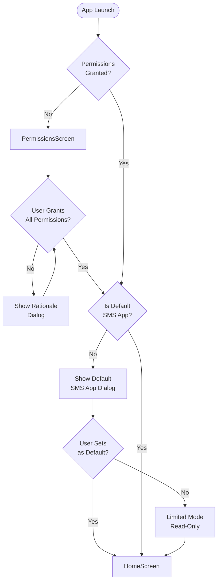
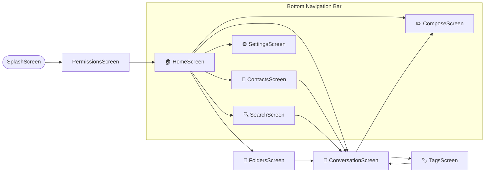
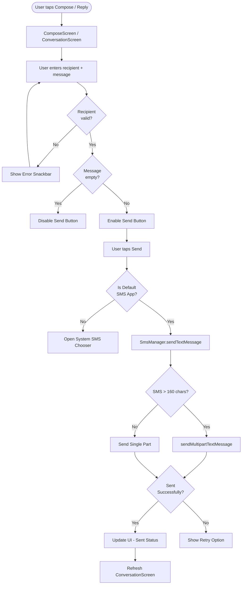
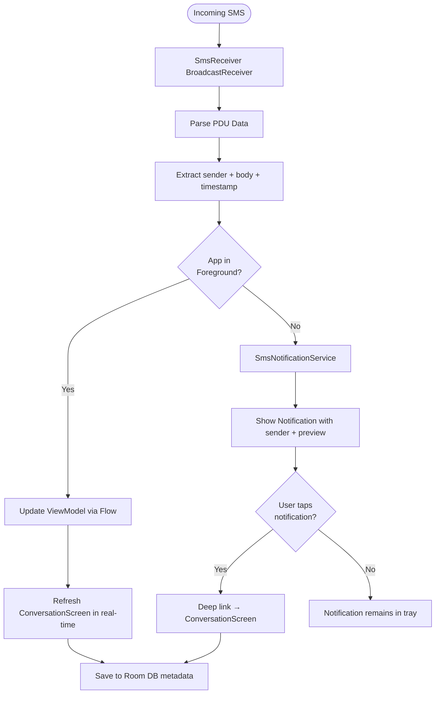
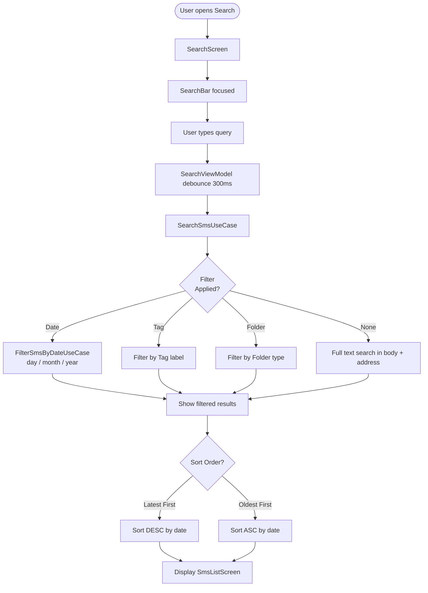
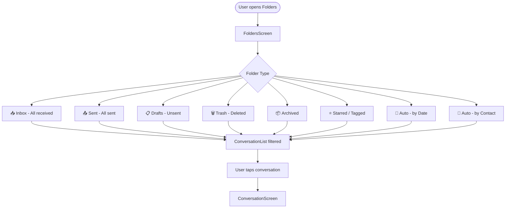
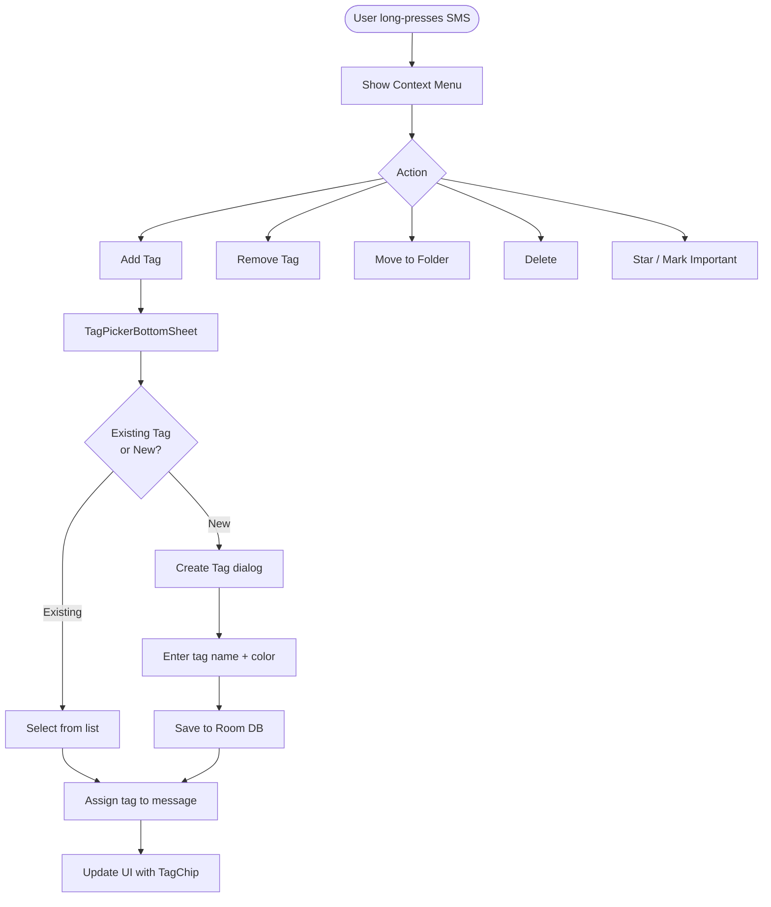
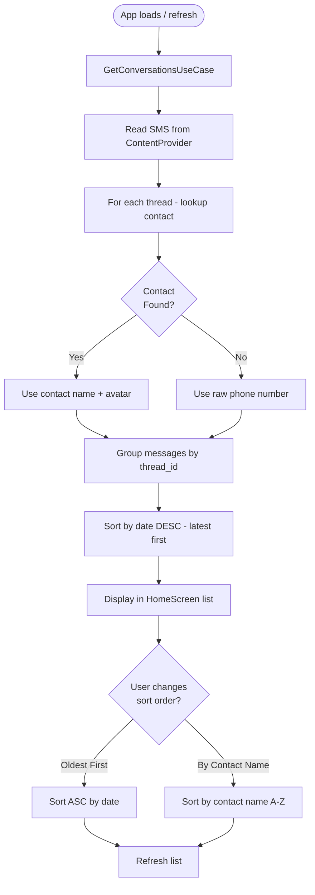
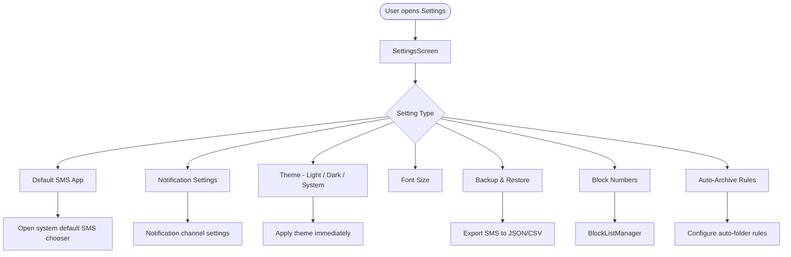
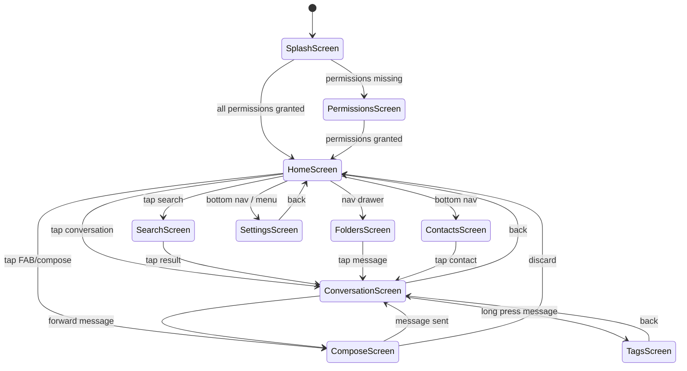

# 📊 SMS Application — Flowcharts & Navigation Diagrams

## 1. App Launch & Permission Flow

---

## 2. Main Navigation Graph

---

## 3. SMS Send Flow

---

## 4. SMS Receive Flow

---

## 5. Search & Filter Flow

---

## 6. Folder & Grouping Flow

---

## 7. Tag Management Flow

---

## 8. Contact Grouping Flow

---

## 9. Settings Flow

---

## 10. Full Screen State Machine

